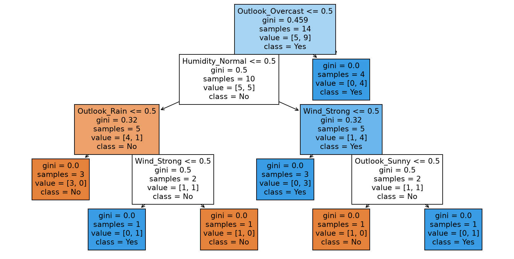

# Decision Tree Algorithms: ID3, C4.5 and CART

## Objective
To apply and compare three decision tree algorithms (ID3, C4.5 and CART)
on the Play Tennis dataset.

## Dataset
Play Tennis: 14 rows, 4 categorical features (Outlook, Temp, Humidity, Wind)
and 1 target (Decision: Yes/No).

## Tools Used
Python 3.11, chefboost (ID3, C4.5, CART), pandas, scikit-learn, matplotlib.

## How to Run (Mac)
```bash
git clone https://github.com/Bakhtawar560/decision-tree-id3-c45-cart.git
cd decision-tree-id3-c45-cart
python3 -m venv venv
source venv/bin/activate
pip install -r requirements.txt
mkdir -p outputs/rules
touch outputs/__init__.py outputs/rules/__init__.py
PYTHONPATH=. python3 src/trees.py
python3 src/cart_plot.py
```

## Algorithms Compared

| Algorithm | Split Criterion | Data Handled | Split Type |
|---|---|---|---|
| ID3 | Information Gain (Entropy) | Categorical only | Multi-way |
| C4.5 | Gain Ratio | Categorical and numeric | Multi-way |
| CART | Gini Index | Categorical and numeric | Binary |

## Results

| Algorithm | Accuracy | Prediction for (Sunny, Cool, Normal, Weak) |
|---|---|---|
| ID3 | 100% | Yes |
| C4.5 | FILL IN | FILL IN |
| CART | FILL IN | FILL IN |

The learned rules are saved in the `outputs/rules` folder.

CART tree drawn with scikit-learn:



## Conclusion
FILL IN